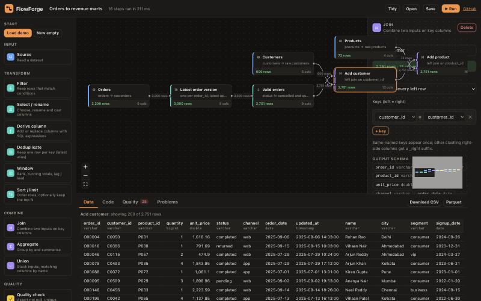
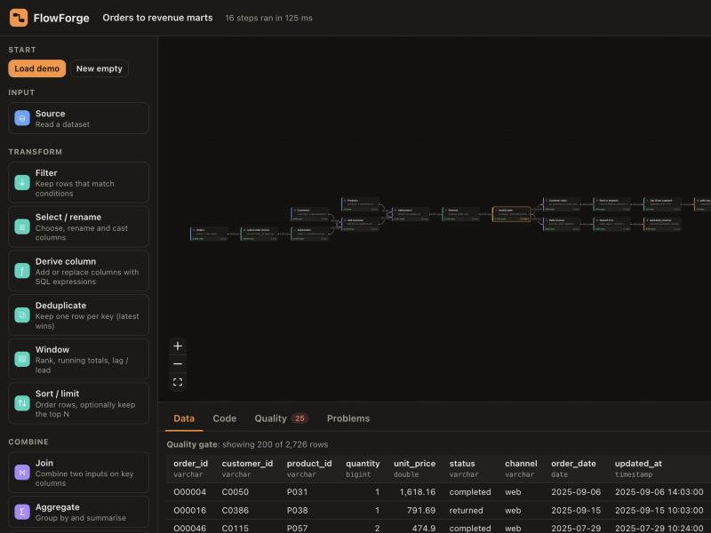
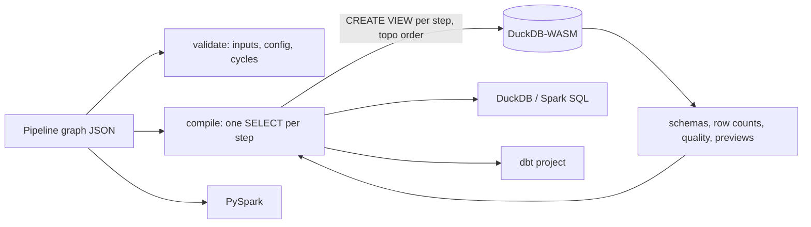

# FlowForge

**Build ETL pipelines visually, run them instantly, and take the code with you.** Drag steps onto a canvas, connect them, and every change runs on **DuckDB inside your browser**: row counts, schemas, previews and data-quality results update as you type. The same graph then exports as **DuckDB SQL, Spark SQL, a PySpark job and a ready-to-run dbt project**.

Static site, no backend, nothing uploaded. Hosted free on GitHub Pages.

**[Live demo →](https://adityamalviya04692.github.io/flowforge/)**




## Features

| | |
|---|---|
| **12 step types** | Source, Filter, Select/rename/cast, Derive (SQL expressions), Deduplicate (latest per key), Window (rank, running total, lag/lead), Sort/limit, Join (inner/left/right/full), Aggregate, Union (by name), Quality check, Output |
| **Live execution** | Each step is a DuckDB view; any config change re-runs the graph (debounced) in ~100–250 ms on the sample data. Row counts flow along the edges. |
| **Errors where they happen** | A broken step shows its own error; its descendants are marked *blocked* while every other branch still runs. |
| **Data quality** | Not-null, unique, between, accepted values, regex, either *warn* or *drop failing rows*. Failing-row counts are shown per check and exported as dbt tests. |
| **Code generation** | DuckDB SQL and Spark SQL (one CTE chain per output), PySpark DataFrame code, and a dbt project (`sources.yml`, one model per output, `schema.yml` tests, `dbt_utils` when needed). Download everything as a .zip. |
| **Your own data** | Upload CSV, Parquet or JSON. It's loaded into DuckDB-WASM and never leaves the tab. Export any step as CSV or Parquet. |
| **Persistence** | Autosaves to the browser; Save/Open pipelines as JSON. |
| **CRT workstation** | Phosphor display, stepped circuit traces, docked node library and inspector, and a full-width results console. Mobile tabs switch between library, graph and inspector. |
| **DuckDB terminal** | Execute SQL against the current session, inspect real EXPLAIN plans, and use table shortcuts. Ctrl/Cmd + Enter executes the query. |
| **Telemetry** | Per-node row counts, measured execution time, quality assertions and latest execution results. Select a node to inspect it in the editor. |
| **Display preferences** | Green, amber and white phosphor, optional scanlines and a local autosave toggle. Preferences persist in this browser. |

The workstation UI adapts the supplied Cathode Terminal Architecture designs. Hardware-style framing is decorative; telemetry shows actual pipeline measurements rather than simulated CPU, memory or network activity. Press **F5** to execute the pipeline and **Escape** to deselect a node.

## The demo pipeline

`orders → latest version per order → valid orders → + customers → + products → revenue → quality gate`, which then branches into **gold.daily_revenue** (by day and category) and **gold.top_customers** (top 10 per segment by lifetime value). The sample data (`scripts/generate-samples.mjs`, seeded and synthetic) includes late-arriving duplicates, cancelled orders, zero or negative quantities and missing customer ids, so every step has something to do.



## How it works



- **One compiler, three targets.** Each step compiles to a single `SELECT` over its inputs. The runtime wraps them as views; the SQL export chains them as CTEs; dbt reuses them with `{{ source() }}` refs. PySpark has its own emitter with the same semantics: explicit join column lists, `unionByName`, window specs.
- **Schema-aware.** Column lists come from DuckDB `DESCRIBE` of each upstream view, so joins emit explicit, collision-free column lists (`_right` suffixes) that work identically in DuckDB, Spark and dbt.
- **Tested against a real engine.** The test suite runs pipelines on native DuckDB (`@duckdb/node-api`), checks the results (dedupe counts, quality drops, mart totals), executes the **exported SQL script end to end** and compares it with the in-app result, and syntax-checks the generated PySpark with Python's `ast`.

## Tech stack

TypeScript · React 19 · React Flow + dagre · DuckDB-WASM · CodeMirror 6 · fflate · Vitest + native DuckDB · GitHub Actions · GitHub Pages

## Run locally

```bash
npm install
npm run dev        # http://localhost:5173
npm test           # 17 tests on native DuckDB (needs python3 for the PySpark syntax check)
npm run build
npm run samples    # regenerate the sample CSVs
```

## Deploy (free)

Push to a public repo named `flowforge`, then go to **Settings → Pages → Source** and choose **GitHub Actions**. Every push to `main` tests, builds and deploys.

## Limitations

- Derive expressions are passed through as SQL, so use functions that exist in both DuckDB and Spark (most standard SQL does).
- Uniqueness checks report duplicates but don't drop rows (use a Deduplicate step).
- Previews show 200 rows; very large files are limited by browser memory.

## License

MIT © Aditya Malviya
